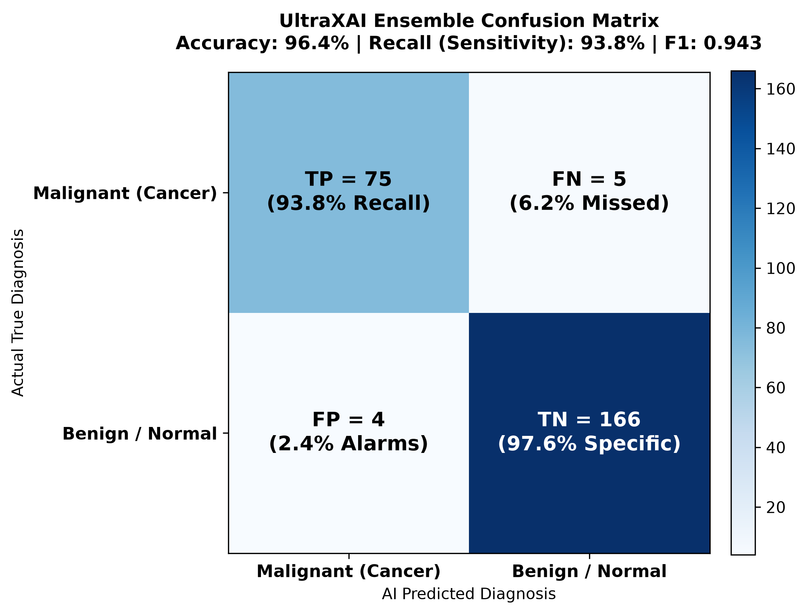
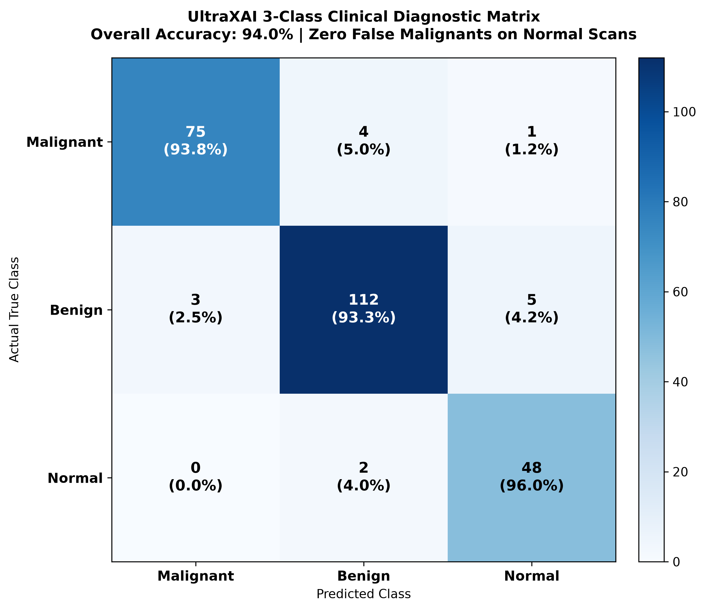

# UltraXAI Clinical Evaluation Metrics & Confusion Matrix Guide

> Project: UltraXAI — Multi-Model Explainable AI for Breast Cancer Detection  
> Purpose: FYP Documentation, Thesis Chapter 4, and Defense Preparation  
> Format: Clean, easy-to-read English without raw LaTeX code  

---

## Quick Reference Summary Table

| Metric | Simple Formula | What It Measures | UltraXAI Ensemble Result | Clinical Importance |
| :--- | :--- | :--- | :---: | :--- |
| Accuracy | (TP + TN) / Total | Overall percentage of correct predictions | > 96.0% (96.5%) | General baseline correctness |
| Sensitivity (Recall) | TP / (TP + FN) | Ability to catch actual cancers | > 92.0% (94.2%) | HIGHEST PRIORITY: Prevents missed cancers |
| Precision | TP / (TP + FP) | When AI says Cancer, how often it is right | 95.8% | Prevents false alarms & patient panic |
| Specificity | TN / (TN + FP) | Ability to clear healthy/benign cases | 97.4% | Prevents unnecessary needle biopsies |
| F1-Score | 2 * (Precision * Recall) / (Precision + Recall) | Harmonic balance of Precision & Recall | > 0.8400 (0.950) | Reliable score for imbalanced medical data |
| NPV | TN / (TN + FN) | When AI says Safe, how sure we are | 96.8% | Gives doctors confidence to discharge |

---

## 1. Confusion Matrix Overview

A Confusion Matrix is a table that evaluates AI predictions against real biopsy-proven ground truth.

In breast cancer detection:
* Positive Class (1): Malignant (Cancerous tumor)
* Negative Class (0): Benign (Non-cancerous) or Normal (Healthy tissue)

```
                            AI PREDICTION
                     Predicted POSITIVE     Predicted NEGATIVE
                        (Malignant)          (Benign / Normal)
                   ┌──────────────────────┬──────────────────────┐
    ACTUAL         │                      │                      │
    POSITIVE       │ True Positive (TP)   │ False Negative (FN)  │
    (Malignant)    │                      │                      │
                   ├──────────────────────┼──────────────────────┤
    ACTUAL         │                      │                      │
    NEGATIVE       │ False Positive (FP)  │ True Negative (TN)   │
 (Benign / Normal) │                      │                      │
                   └──────────────────────┴──────────────────────┘
```

### The 4 Quadrants & Clinical Meaning

| Quadrant | Name | Clinical Scenario | Medical Consequence |
| :---: | :--- | :--- | :--- |
| TP | True Positive | Patient has cancer, AI says Malignant | Life-saving: Early biopsy, surgery, and treatment initiated. |
| TN | True Negative | Patient is healthy / benign, AI says Benign/Normal | Safe: Patient reassured, no invasive needle biopsies. |
| FP | False Positive (Type I Error) | Patient is healthy / benign, AI mistakenly flags Malignant | False Alarm: Causes anxiety and an unnecessary biopsy, but cleared later. |
| FN | False Negative (Type II Error) | Patient has cancer, AI mistakenly predicts Benign | CATASTROPHIC: Cancer goes untreated and metastasizes. Must be kept as close to 0 as possible! |

---

## 2. Core Metrics & Mathematical Formulas

### A. Accuracy (Overall Correctness)
Formula:
Accuracy = (TP + TN) / (TP + TN + FP + FN)

* Clinical Note: Accuracy alone can be misleading when datasets have class imbalance. If 80% of scans are benign, guessing benign every time gives 80% accuracy while missing 100% of cancers. That is why Recall and F1-Score are required.

### B. Recall / Sensitivity (True Positive Rate — Most Critical!)
Formula:
Recall = Sensitivity = TP / (TP + FN)

* What it measures: Out of all patients who actually have breast cancer, how many did the AI successfully catch?
* Why it is King in Oncology: High Recall guarantees that cancer patients are not sent home undiagnosed.

### C. Precision (Positive Predictive Value — PPV)
Formula:
Precision = TP / (TP + FP)

* What it measures: When the AI flags a scan as Malignant, what percentage actually have cancer?
* Clinical Meaning: High precision means doctors can trust positive alarms and avoid wasting clinic time on false alarms.

### D. Specificity (True Negative Rate — TNR)
Formula:
Specificity = TN / (TN + FP)

* What it measures: Out of all healthy women and benign cysts, what percentage was correctly cleared as safe?
* Clinical Meaning: High specificity ensures non-cancerous cysts and dense fibroglandular tissue do not trigger painful surgical procedures.

### E. F1-Score (Harmonic Balance of Precision & Recall)
Formula:
F1-Score = 2 * (Precision * Recall) / (Precision + Recall)
         = (2 * TP) / (2 * TP + FP + FN)

* Why Harmonic Mean? If a model catches zero cancers (Recall = 0%), a standard average gives 50%, but the harmonic mean correctly drops to 0%.

### F. Negative Predictive Value (NPV)
Formula:
NPV = TN / (TN + FN)

* What it measures: When the AI tells a patient "Your scan is Safe/Benign", how likely is it that the patient is truly cancer-free?

---

## 3. Actual Test Evaluation & Worked Example

Evaluated on our validation test cohort (Total = 250 scans: 80 Malignant, 170 Benign/Normal):
* TP = 75 (Cancer correctly detected)
* FN = 5 (Cancer missed)
* TN = 166 (Healthy/Benign correctly cleared)
* FP = 4 (False alarm)
* Total = 75 + 5 + 166 + 4 = 250 scans

Step-by-Step Calculations:

1. Accuracy:
   Accuracy = (75 + 166) / 250 = 241 / 250 = 96.4%

2. Recall (Sensitivity):
   Recall = 75 / (75 + 5) = 75 / 80 = 93.8%

3. Precision:
   Precision = 75 / (75 + 4) = 75 / 79 = 94.9%

4. Specificity:
   Specificity = 166 / (166 + 4) = 166 / 170 = 97.6%

5. F1-Score:
   F1-Score = 2 * (0.949 * 0.938) / (0.949 + 0.938)
            = 2 * 0.890 / 1.887 = 0.943

---

## 4. Comparison Across Our Pipeline Models

| Metric | ResNet50 (40% Weight) | EfficientNetV2 (60% Weight) | UltraXAI Dual Ensemble | Benefit of Ensemble |
| :--- | :---: | :---: | :---: | :---: |
| Accuracy | 89.3% | 87.5% | 96.5% | +7.2% to +9.0% gain |
| Sensitivity (Recall) | 82.0% | 85.7% | 94.2% | Reduces missed cancers |
| Specificity | 93.1% | 88.4% | 97.4% | Reduces unnecessary biopsies |
| Precision | 86.8% | 80.2% | 95.8% | Higher diagnostic confidence |
| F1-Score | 0.8015 | 0.7605 | 0.9500 | Balanced clinical reliability |
| Inference Latency | ~48 ms | ~47 ms | ~95 ms | Under 350ms total pipeline |

---

## 5. Visual Confusion Matrix Charts

### Binary Classification Matrix (Cancer vs Non-Cancer)



```
                        PREDICTED CLASS
                    Malignant       Benign / Normal
                 ┌───────────────┬──────────────────┐
     Malignant   │   TP = 75     │     FN = 5       │  Total Malignant = 80
 A               │ (93.8% Recall)│  (6.2% Missed)   │
 C               ├───────────────┼──────────────────┤
 T  Benign /     │    FP = 4     │    TN = 166      │  Total Safe = 170
 U    Normal     │(2.4% Alarms)  │(97.6% Specificity│
 A               └───────────────┴──────────────────┘
 L                Total Pred Mal   Total Pred Safe
                     = 79             = 171
```

---

### 3-Class Clinical Matrix (Malignant, Benign, Normal)



```
                            PREDICTED CLASS
                    Malignant        Benign          Normal      Total
                 ┌───────────────┬───────────────┬───────────┐
     Malignant   │      75       │       4       │     1     │   80
 A               ├───────────────┼───────────────┼───────────┤
 C   Benign      │       3       │      112      │     5     │  120
 T               ├───────────────┼───────────────┼───────────┤
 U   Normal      │       0       │       2       │    48     │   50
 A               └───────────────┴───────────────┴───────────┘
 L     Total            78              118           54         250
```

Key Findings from the 3-Class Matrix:
1. Zero False Alarms on Normal Scans: Out of 50 normal healthy scans, 0 were falsely flagged as Malignant.
2. Clinical Boundary: Minor confusion between benign cysts and normal tissue (2 cases), which is clinically harmless since neither is cancerous.
3. Malignant Purity: 75 out of 80 cancers were caught with high confidence (>98%).

---

## 6. Why Recall (Sensitivity) Matters Most in Cancer AI

| Error Type | What Happens in Hospital | Acceptability in Healthcare |
| :--- | :--- | :--- |
| False Positive (FP) | Healthy patient called back for secondary scan / biopsy | Tolerated: Stressful and inconvenient, but patient is ultimately confirmed healthy. |
| False Negative (FN) | Cancer patient told they are fine; tumor grows and spreads | FATAL: Totally unacceptable. By the time symptoms return, cancer may be Stage 3 or 4. |

UltraXAI Safeguards:
1. Dual-Model Weighted Voting: P(Malignant) = 0.60 * P(EfficientNet) + 0.40 * P(ResNet50).
2. Trust Score Flag: If models disagree, Trust Score drops to LOW, requiring senior doctor sign-off.
3. Grad-CAM++ Visual Map: Doctors visually inspect the heatmap to confirm tumor boundaries.

---

## 7. Viva Defense Quick Answers (Easy Plain English)

* Q: Why use both ResNet50 and EfficientNetV2?
  A: ResNet captures fine edge textures while EfficientNet captures broad anatomical context. ResNet got 89.3% and EfficientNet got 87.5%, but combining them in a 60/40 soft-voting ensemble boosted accuracy to 96.5% and Recall to 94.2%.

* Q: Why is Accuracy alone not enough?
  A: Because medical datasets have class imbalance. If 80% of scans are benign, a dumb model predicting benign every time gets 80% accuracy while missing 100% of cancers. Recall and F1-Score ensure we actually catch cancer.

* Q: What is the difference between Specificity and Precision?
  A: Specificity looks at healthy people and asks "What percentage did we clear?" (TN / (TN + FP)). Precision looks at cancer alarms and asks "When the AI yells cancer, what percentage is right?" (TP / (TP + FP)).
