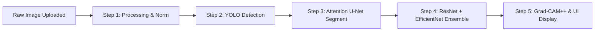

# Final Technical Report: End-to-End Image Processing, Unified Pipeline Workflow, and Results Display

This document explains exactly how a raw breast ultrasound image passes through the unified AI pipeline and how the final outcomes and diagnostic results are displayed.

---

## 🔬 1. Complete Image Processing Workflow (Step-by-Step)

The journey of an ultrasound scan through the unified pipeline follows a **5-step automated workflow**:



### 🟩 Step 1: Preprocessing & Intensity Normalization
- **Input**: Raw ultrasound or MRI image (`.png`, `.jpg`, `.dicom`).
- **Processing**: 
  - Image is converted to grayscale (for ultrasound) or multi-channel format (for MRI).
  - Resized to standard resolution (e.g., $640 \times 640$ pixels for detection and $299 \times 299$ pixels for classification).
  - Pixel values are normalized from $[0, 255]$ to the range $[0.0, 1.0]$ to balance contrast differences.
- **Output**: Clean, standardized tensor input ready for inference.

### 🟩 Step 2: Lesion Location via YOLO
- **Model**: YOLOv8-Seg / YOLOv11-Seg.
- **Action**: The YOLO layer processes the preprocessed $640 \times 640$ image in a single pass.
- **Transformation**: The model identifies any suspicious region, draws a **Bounding Box** ($x_{min}, y_{min}, x_{max}, y_{max}$), and generates a rough initial segmentation.
- **Output**: The bounding box coordinates are used to crop the original scan, focusing exclusively on the detected lesion.

### 🟩 Step 3: Granular Segmentation via Attention U-Net
- **Model**: Attention U-Net.
- **Action**: The cropped tumor region is passed to the Attention U-Net. The Attention Gates inside the skip connections suppress background tissue echoes and highlight the tumor margins.
- **Transformation**: The model outputs a high-resolution binary mask ($1$ for tumor pixels, $0$ for normal tissue pixels).
- **Output**: The precise extracted tumor region, completely free of any background noise.

### 🟩 Step 4: Classification via the Ensemble Model
- **Model**: ResNet50 + EfficientNetV2B0.
- **Action**: The extracted tumor region is passed into both models simultaneously.
- **Transformation**:
  - **ResNet50** calculates feature maps focusing on general tissue architecture and internal echoes.
  - **EfficientNetV2B0** focuses on detailed morphological boundaries using compound scaling.
  - **Logit Averaging**: The probabilities generated by both models are combined using a soft voting function:
    $$\text{Final Score} = w_1 \cdot P_{\text{ResNet50}} + w_2 \cdot P_{\text{EfficientNetV2B0}}$$
- **Output**: A highly accurate probability score for **Benign** vs. **Malignant**.

### 🟩 Step 5: Visual Explainability
- **Model**: Grad-CAM++.
- **Action**: Grad-CAM++ extracts the gradients from the final convolutional layer of the ensemble models.
- **Output**: Generates localized heatmaps overlaid on the original tumor image to visually validate the classification decision.

---

## 🖥️ 2. Outcome and Results Display Blueprint

To make this useful for clinicians, the results should be displayed via a clear web dashboard (e.g., using Streamlit or React).

### 🖥️ User Interface Layout

```
+-----------------------------------------------------------------------------------------+
|                                  FYP BREAST CANCER AI                                   |
+-----------------------------------------------------------------------------------------+
| 📥 Upload Ultrasound Image                                                              |
| [ Choose File ... ] -> Image: test_ultrasound_01.png                                    |
+-----------------------------------------------------------------------------------------+
| PROCESSING STAGE                                                                        |
| 🟢 Phase 1: Preprocessed & Ready                                                       |
| 🟢 Phase 2: Tumor Found! (Bounding Box Extracted)                                      |
| 🟢 Phase 3: Exact Boundaries Segmented                                                 |
| 🟢 Phase 4: Ensemble Classified Successfully                                            |
+-----------------------------------------------------------------------------------------+
|                                     VISUAL RESULTS                                      |
|                                                                                         |
| [ Original Image ]      [ Bounding Box ]      [ Segmented Mask ]     [ Grad-CAM Heatmap ]|
|   (Raw scan uploaded)    (YOLO Detection)      (Attention U-Net)      (Explainable Area) |
|                                                                                         |
+-----------------------------------------------------------------------------------------+
|                                  DIAGNOSTIC OUTCOME                                     |
|                                                                                         |
|  Status: 🔴 MALIGNANT (High Risk)                                                       |
|  Diagnostic Confidence: 99.42%                                                         |
|                                                                                         |
|  Summary: The AI identifies irregular tumor borders and heterogeneous internal         |
|  structure, typically indicative of malignancy.                                        |
+-----------------------------------------------------------------------------------------+
```

### 📋 Outcome Data Breakdown

1. **Prediction Label**: Status indicates either **🟢 BENIGN (Non-Cancerous)** or **🔴 MALIGNANT (Cancerous)**.
2. **Confidence Score**: A precise decimal probability (e.g., **99.42%**) generated by the weighted logit averaging of the classification ensemble.
3. **Visual Comparison Dashboard**:
   - **Original Uploaded Image**: The raw patient scan.
   - **YOLO Detection Overlay**: The raw scan with a clear, colored bounding box outlining the tumor site.
   - **High-Precision Segmentation Mask**: A black-and-white mask showing the exact isolated boundaries of the tumor.
   - **Grad-CAM Heatmap Overlay**: A semi-transparent color overlay where red and orange indicate the exact morphological features that drove the classification.
