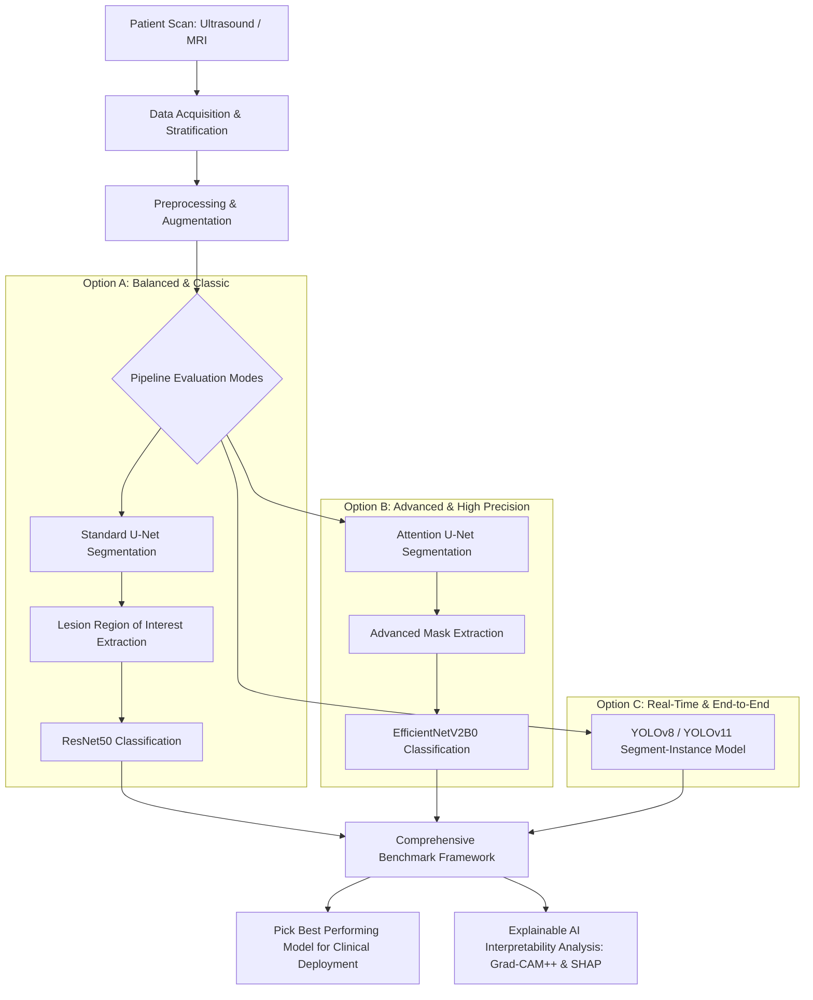

# FINAL FYP PROPOSAL: Automated Breast Cancer Detection and Classification Using Multi-Model Pipeline Architectures

---

## 1. Executive Summary

This document proposes a comprehensive multi-model benchmarking framework for the detection, segmentation, and classification of breast cancer using ultrasound and MRI datasets. The core strategy is to implement and benchmark three major state-of-the-art deep learning paradigms (**Option A: Balanced**, **Option B: Advanced**, and **Option C: Real-Time**) to evaluate their diagnostic accuracy, parameter efficiency, and operational speed. This delivers a robust, academically sound, and clinically valuable comparative study for a Final Year Project (FYP).

---

## 2. Methodology & Multi-Model Pipelines

The proposed system trains and tests three separate end-to-end pipelines using the same preprocessed datasets to determine the optimal diagnostic solution for real-world deployment.

### Option A: Balanced & Classic (Baseline)
1. **Lesion Segmentation**: The input ultrasound image passes through a standard **U-Net** architecture. The encoder extracts low-level and high-level features, while the decoder reconstructs the tumor mask using skip connections.
2. **ROI Extraction**: The original image is cropped around the predicted lesion mask to isolate the exact tumor.
3. **Tumor Classification**: The isolated tumor region is fed into a **ResNet50** classification model to predict whether the tumor is **Benign** or **Malignant**.

### Option B: Advanced & High-Precision (SOTA)
1. **Attention Segmentation**: Input images pass through an **Attention U-Net**. Attention gates are integrated into the skip connections to suppress irrelevant background tissue and highlight the exact margins of the tumor.
2. **ROI Extraction**: Advanced cropping filters out the image background based on the attention-guided mask.
3. **Tumor Classification**: The extracted region is classified using **EfficientNetV2B0**, utilizing its progressive learning and compound scaling for high accuracy with fewer parameters.

### Option C: Real-Time End-to-End (Single Stage)
1. **Single-Pass Detection & Masking**: The raw image is fed directly into **YOLOv8-Seg** or **YOLOv11-Seg**.
2. **Simultaneous Processing**: The model extracts bounding boxes (Localization), creates instance segmentation outlines (Masking), and outputs predictions (Classification) simultaneously in a single forward pass.

---

## 3. Technology Stack

To ensure excellent development speed and deep learning performance, the following modern Python-based AI/ML stack is used:

### Core Environment & Deep Learning Frameworks
- **Python**: 3.11 or 3.12
- **PyTorch & PyTorch Lightning**: Primary framework for Options A & B, offering high flexibility for dynamic graph generation.
- **Ultralytics**: Framework for Option C (YOLOv8/v11-Seg).

### Image Processing & Preprocessing
- **OpenCV & SimpleITK**: For loading, color-space conversion, and region-of-interest cropping.
- **Albumentations**: Advanced medical image augmentation (Elastic transforms, Speckle noise filters, Grid distortion).

### Evaluation & Explainable AI (XAI)
- **Scikit-learn**: For generating stratified k-fold splits, validation matrices, and metric scores.
- **Grad-CAM++**: For localized heatmap visual explanations overlaying predictions.
- **SHAP**: For game-theoretic evaluations of overall feature contributions.

---

## 4. Evaluation and Performance Benchmarking

To determine the most accurate pipeline, all models will be evaluated across two distinct phases:

### 1. Segmentation Metrics (Options A, B & C)
- **Dice Similarity Coefficient (DSC)**: Measures the spatial overlap between ground-truth masks and predicted masks.
- **Intersection over Union (IoU)**: Validates target localization accuracy.

### 2. Classification Metrics (Options A, B & C)
- **Overall Accuracy**: Total correct predictions over all evaluations.
- **Sensitivity (Recall)**: The ability to correctly identify all true malignant tumors.
- **Specificity**: The ability to correctly identify true benign/normal tissue.
- **F1-Score**: The balance between Precision and Recall.
- **Inference Speed (FPS)**: Total time taken per image to output a diagnosis.
