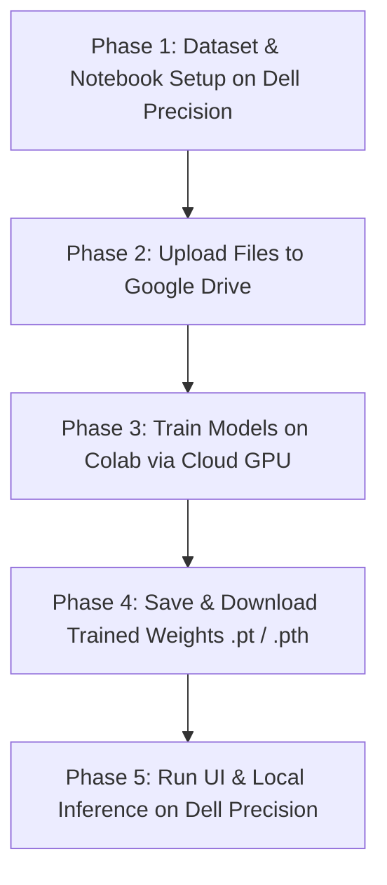

# Workflow Guide: Using Google Colab Pro with your Dell Precision

This guide outlines exactly how you will split the development load between Google Colab (for heavy cloud training) and your local Dell Precision laptop (for testing and inference).

---

## 📈 Step-by-Step Collaborative Workflow

By splitting the workload, you keep your laptop fast and completely prevent it from overheating while the cloud trains your AI.

---

## 🔄 The 5 Steps in Detail

### 🟩 Step 1: Prepare the Dataset on your Laptop
- You collect and organize your ultrasound images and masks on your **Dell Precision**.
- You create a single `.zip` file of the dataset (`dataset.zip`) to make uploading fast and easy.

### 🟩 Step 2: Upload to Google Drive
- Open the browser on your laptop, go to **Google Drive**, and upload `dataset.zip`.
- Create or upload your PyTorch / YOLOv8 training notebook (`training.ipynb`).

### 🟩 Step 3: Train in the Cloud (Google Colab Pro)
- Open the notebook inside **Google Colab** in your browser.
- Select the **NVIDIA T4, V100, or A100 GPU** runtime from the top menu.
- Run the notebook. Colab will unzip your dataset from Google Drive and train your models.
- **Laptop Status**: Your Dell Precision fans stay quiet, the CPU stays cool, and you can easily do other work while the cloud takes all the training load.

### 🟩 Step 4: Download the Trained Weights
- Once the training epochs are complete, the code will save the trained weights (e.g., `best.pt` for YOLO or `segmentation_model.pth` for the Attention U-Net) directly to your Google Drive.
- Download these small weight files (usually around 20 MB to 100 MB) back onto your **Dell Precision 5540**.

### 🟩 Step 5: Run the Web Dashboard Locally
- You open VS Code on your laptop and load the downloaded weights into your project directory.
- Start your local web dashboard (e.g., using Streamlit, FastAPI, or React).
- Test it out: upload a new ultrasound image, and your laptop's built-in NVIDIA card will process and display the exact segmented mask, heatmap, and diagnosis instantly.
