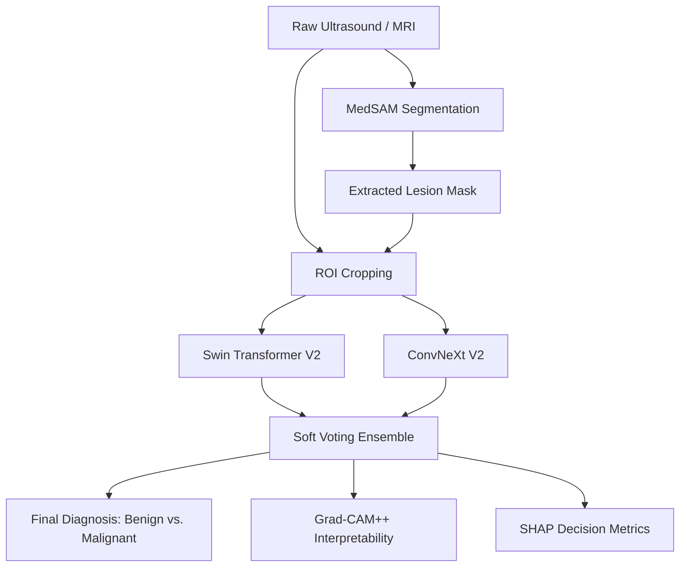

# State-of-the-Art (SOTA) Medical AI Implementation Plan

This technical proposal outlines the ultimate, high-performance SOTA pipeline for near-perfect accuracy in detecting and classifying breast cancer from ultrasound and MRI images.

---

## 🔬 SOTA Architecture Overview

The ultimate state-of-the-art pipeline leverages a **Two-Stage Hybrid Architecture**: **MedSAM (Segmentation)** + **Swin Transformer V2 / ConvNeXt V2 Ensemble (Classification)** + **Explainable AI (XAI)**.

---

## 🛠️ The Absolute SOTA Tech Stack

### 1. Medical Image Preprocessing & Augmentation
- **nnU-Net Preprocessing Pipeline**: Automatically computes dataset-specific spacing, intensity normalization, and resizing based on your image properties.
- **Albumentations**: Medical-specific augmentations (Elastic Transform, Grid Distortion, Speckle Noise reduction).

### 2. Tumor Segmentation (Stage 1)
- **MedSAM (Medical Segment Anything Model)**: The absolute bleeding edge in zero-shot and fine-tuned medical image segmentation. Outperforms basic U-Net and Swin-UNet by leveraging large-scale vision foundation models.

### 3. Feature Extraction & Classification (Stage 2)
- **Swin Transformer V2**: State-of-the-art hierarchical Vision Transformer that captures fine-grained spatial and global long-range context.
- **ConvNeXt V2**: The pinnacle of Convolutional Neural Networks, optimizing classic CNN layers with transformer training paradigms for incredible local feature extraction.
- **Soft Ensemble (Voting Classifier)**: Combines the outputs of Swin Transformer V2 and ConvNeXt V2 to minimize individual model error and maximize overall accuracy.

### 4. Advanced Interpretability & Clinical Verification
- **Grad-CAM++**: Overlays fine-grained class activation maps directly onto the segmented lesion area.
- **LIME / SHAP**: Provides exact pixel-level attribution to support clinical confidence.

---

## 📈 Step-by-Step Implementation Workflow

### Step 1: Segmentation Fine-Tuning
1. Load the pre-trained **MedSAM** foundation model.
2. Fine-tune on the **BUSI** dataset masks to allow zero-shot lesion segmentation.
3. Automatically crop incoming ultrasound scans around the segmented lesion boundaries.

### Step 2: Training the Ensemble Classifier
1. Train **Swin Transformer V2-Base** and **ConvNeXt V2-Base** separately on the cropped lesion ROI.
2. Initialize both models using ImageNet-22K pre-trained weights for excellent transfer learning performance.
3. Use **PyTorch Native AMP (Automatic Mixed Precision)** to train effectively on modern hardware.

### Step 3: Ensemble Voting
1. Combine model logits via **Weighted Averaging** based on validation accuracy.
2. Add a dynamic **Trust Score** based on model consensus to notify clinicians of high-uncertainty edge cases.
