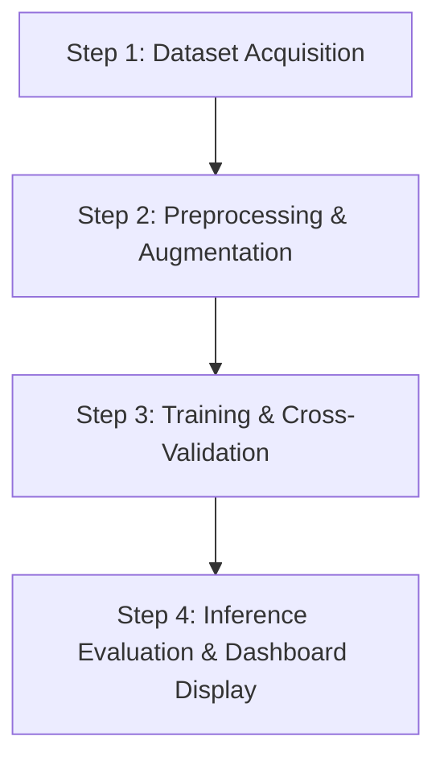
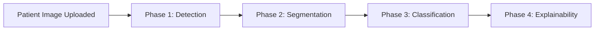

# FINAL FYP PROPOSAL: Automated Multi-Task Hybrid Ensemble Architecture for Breast Cancer Detection

This document outlines the complete methodology, execution pipeline, and structural hierarchy of the proposed artificial intelligence system for detecting, segmenting, and classifying breast cancer from medical images.

---

## 1. System Structural Hierarchy

The structural breakdown of the project segregates the overall framework into clean, module-based operational layers:

```
+---------------------------------------------------------------------------------------------+
|                               PROJECT STRUCTURAL HIERARCHY                                  |
+---------------------------------------------------------------------------------------------+
| MODULE 1: PREPROCESSING & INTENSITY NORMALIZATION LAYER                                     |
|   ├── Pixel Intensity Normalization & Image Resizing                                        |
|   └── Advanced Image Augmentation Framework                                                 |
+---------------------------------------------------------------------------------------------+
| MODULE 2: MULTI-TASK ARTIFICIAL INTELLIGENCE CORE                                           |
|   ├── Stage 1: Lesion Localization & Bounding Box Layer (YOLO Architecture)                 |
|   ├── Stage 2: Lesion Extraction & Segmentation Layer (Attention U-Net)                     |
|   └── Stage 3: Multi-Feature Ensemble Layer (ResNet50 + EfficientNetV2B0)                   |
+---------------------------------------------------------------------------------------------+
| MODULE 3: INTERPRETABILITY & USER INTERFACE LAYER                                           |
|   ├── Visual Explanations Core (Grad-CAM++ Framework)                                       |
|   ├── Feature Attribution Engine (SHAP Interpretation)                                      |
|   └── Results Display Web Dashboard                                                         |
+---------------------------------------------------------------------------------------------+
```

---

## 2. Methodology & Operational Workflow

The project executes an end-to-end processing methodology to ensure both high diagnostic accuracy and full transparency.



### Step 1: Data Acquisition
- **Source**: High-quality public datasets (such as the BUSI dataset and multi-modal clinical scans) containing confirmed benign and malignant pathology labels.

### Step 2: Preprocessing and Normalization
- **Intensity Mapping**: Images are converted to a standardized resolution and pixel values are scaled to a unified range ($[0.0, 1.0]$) to balance contrast differences.
- **Data Augmentation**: Applied on-the-fly using advanced transformation techniques (elastic deformation, speckle noise reduction) to minimize overfitting and improve generalization.

### Step 3: Model Training and Cross-Validation
- **Strategy**: The localized, segmentation, and classification layers are trained until validation accuracy is optimized. Cross-validation is applied to ensure robustness.

### Step 4: Inference Execution and Display
- **Output**: The system performs inference on unseen test scans, creating diagnostic outcomes with high-resolution visual explainability for clinical review.

---

## 3. The Combined Image Processing Pipeline

When a single patient ultrasound image is processed through the system, it traverses **4 linked execution phases**:



### 1️⃣ Phase 1: Detection & Region of Interest Extraction
- **Architecture**: **YOLOv8-Seg** / **YOLOv11-Seg**.
- **Role**: The input image is parsed to locate the exact suspicious lesion site. The model extracts the bounding box and crops the original image. This removes overall image noise.

### 2️⃣ Phase 2: Granular Tumor Masking
- **Architecture**: **Attention U-Net**.
- **Role**: The cropped region is processed by the Attention U-Net. Attention gates suppress background tissue echoes and highlight the irregular, jagged margins of the tumor.
- **Output**: A black-and-white mask showing the exact outline of the isolated tumor.

### 3️⃣ Phase 3: Diagnostic Decision
- **Architecture**: **ResNet50 + EfficientNetV2B0 Soft Ensemble**.
- **Role**: The isolated tumor region is fed into both classification models concurrently. Their individual output logits are combined via a soft voting function:
  $$\text{Final Score} = w_1 \cdot P_{\text{ResNet50}} + w_2 \cdot P_{\text{EfficientNetV2B0}}$$
- **Output**: A definitive probability score for **Benign** vs. **Malignant**.

### 4️⃣ Phase 4: Visual Explanations & Results Display
- **Architecture**: **Grad-CAM++** & **SHAP**.
- **Role**: The gradients from the classification layers are converted into high-resolution visual heatmaps.
- **The Dashboard Displays**:
  - The original scan.
  - The YOLO detected bounding box overlay.
  - The high-precision binary segmentation mask.
  - The localized Grad-CAM heatmap.
  - The final diagnosis status (**🔴 Malignant** vs. **🟢 Benign**) with an accuracy percentage.
