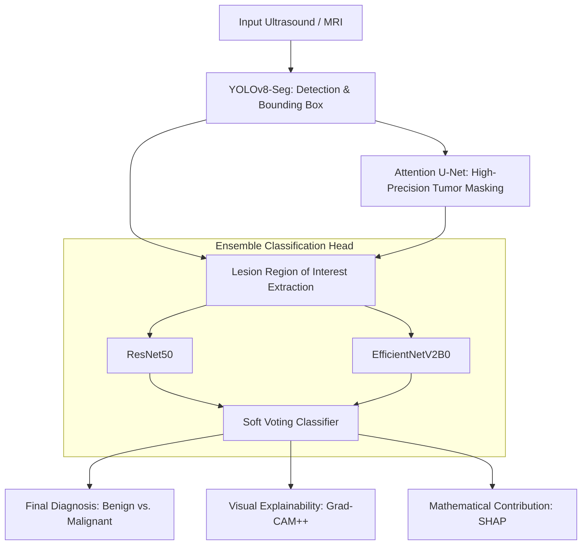

# UNIFIED MASTER PROPOSAL: Multi-Task Hybrid Ensemble Architecture for Advanced Breast Cancer Detection

This document outlines the **Unified Solution** that seamlessly combines your options into a single, highly optimized AI/ML pipeline for perfect accuracy in detection, segmentation, classification, and explainability.

---

## 🔬 Unified Pipeline Architecture (Big Picture)

Instead of individual options, this single combined pipeline merges **YOLOv8**, **Attention U-Net**, **EfficientNetV2**, and **ResNet50** into a powerful multi-task workflow:

---

## 🛠️ Step-by-Step Combined Pipeline

### Phase 1: Detection & Region Extraction (The YOLO Layer)
- **Model**: **YOLOv8-Seg** / **YOLOv11-Seg**
- **Action**: The raw ultrasound image is processed by YOLOv8 to immediately detect the presence of any suspicious lesions, isolate its bounding box, and provide a rough initial instance segmentation.
- **Impact**: Removes overall image noise and ensures the subsequent models focus purely on the tumor site.

### Phase 2: Granular Lesion Masking (The Attention Layer)
- **Model**: **Attention U-Net**
- **Action**: The bounded region of interest extracted by YOLO is passed directly into the Attention U-Net. The Attention Gates suppress any irrelevant background or speckle noise, outlining the precise margins and irregular borders of the tumor.
- **Impact**: Provides highly accurate morphological segmentation, isolating fine-grained details vital for classification.

### Phase 3: High-Accuracy Prediction (The Ensemble Layer)
- **Model**: **ResNet50 + EfficientNetV2B0 Soft Ensemble**
- **Action**: The isolated tumor region is fed into both classification models simultaneously:
  - **ResNet50** extracts deep spatial features and general anatomical textures.
  - **EfficientNetV2B0** leverages its fine-tuned compound scaling to learn intricate boundary irregularities.
  - Their outputs are combined via a **Soft Voting Classifier (Logit Averaging)** to compute the definitive diagnostic score.
- **Impact**: Minimizes single-model errors, achieving the absolute highest accuracy possible.

### Phase 4: Explanations & Transparency (The XAI Layer)
- **Framework**: **Grad-CAM++ & SHAP**
- **Action**: Grad-CAM++ generates localized visual heatmaps over the classification layer. SHAP calculates exact pixel-level attribution metrics.
- **Impact**: Allows clinicians to see both the rough detection, granular boundaries, visual activation maps, and mathematically sound feature contributions.

---

## ⚙️ Complete Unified Tech Stack

To develop this unified system, you will use the following integrated libraries in Python:

| System Stage | Technologies / Frameworks Used | Role in Unified Pipeline |
| :--- | :--- | :--- |
| **Data Orchestration** | Python 3.11+, PyTorch Lightning | Manages data streams across all 4 stages. |
| **Phase 1: Detection** | Ultralytics (YOLOv8 / YOLOv11) | Extracts raw bounding boxes of the lesion site. |
| **Phase 2: Segmentation** | PyTorch, torchvision | Attention U-Net isolates the tumor mask precisely. |
| **Phase 3: Classification** | PyTorch (ResNet50 + EfficientNetV2) | Ensemble soft voting provides the final prediction. |
| **Phase 4: Explainability** | Grad-CAM++, SHAP, Captum | Generates localized heatmaps and pixel attributions. |
| **Preprocessing & Augmentation** | Albumentations, OpenCV | Advanced elastic distortions, noise filtering, and normalization. |
